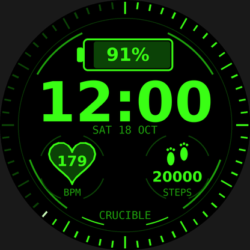

# Crucible

A Jarvis-style HUD watch face for the **Garmin Venu 2 Plus**: neon green on black.



- **Seconds ring**: 60 ticks around the edge that fill up green as the minute passes.
- **Battery** (top middle): percentage inside the icon.
  - 73–100% green
  - 26–72% yellow
  - 5–25% red
  - 0–4% blinking red
- **Time** under the battery, with the date under it. Follows the watch's 12/24-hour setting.
- **Heart rate** (left): inside a heart.
- **Steps** (right): under a pair of footprints.
- **Always-on mode**: only a dim, slowly moving time is shown, to protect the AMOLED screen from burn-in.

The previews in `preview/` are mock-ups. Fonts on the watch look slightly different.

## Folder layout

```
Crucible/
├── manifest.xml          app id, type (watch face), target device
├── monkey.jungle         build config
├── source/
│   ├── CrucibleApp.mc    entry point
│   ├── CrucibleView.mc   places every HUD module on screen
│   ├── core/
│   │   ├── Palette.mc    all colours
│   │   └── Sensors.mc    battery, heart rate, steps
│   └── hud/
│       ├── HudFrame.mc     inner ring, bracket arcs, CRUCIBLE tag
│       ├── SecondsRing.mc  60-tick seconds ring
│       ├── BatteryGauge.mc
│       ├── TimeDisplay.mc  time + date
│       ├── HeartWidget.mc
│       └── StepsWidget.mc
├── resources/            app name and launcher icon
└── preview/              mock-up images
```

## Build and install

1. Install the [Connect IQ SDK](https://developer.garmin.com/connect-iq/sdk/) with the SDK Manager, and download the **Venu 2 Plus** device in it.
2. Install VS Code and the **Monkey C** extension.
3. In VS Code run **Monkey C: Generate a Developer Key** (one time).
4. Open this `Crucible` folder and run **Monkey C: Run** to see it in the simulator.
5. To put it on the watch, run **Monkey C: Build for Device** and choose `venu2plus`.
   Plug the watch in by USB and copy the `.prg` file into `GARMIN/APPS` on it.
   Then pick Crucible as your watch face.
